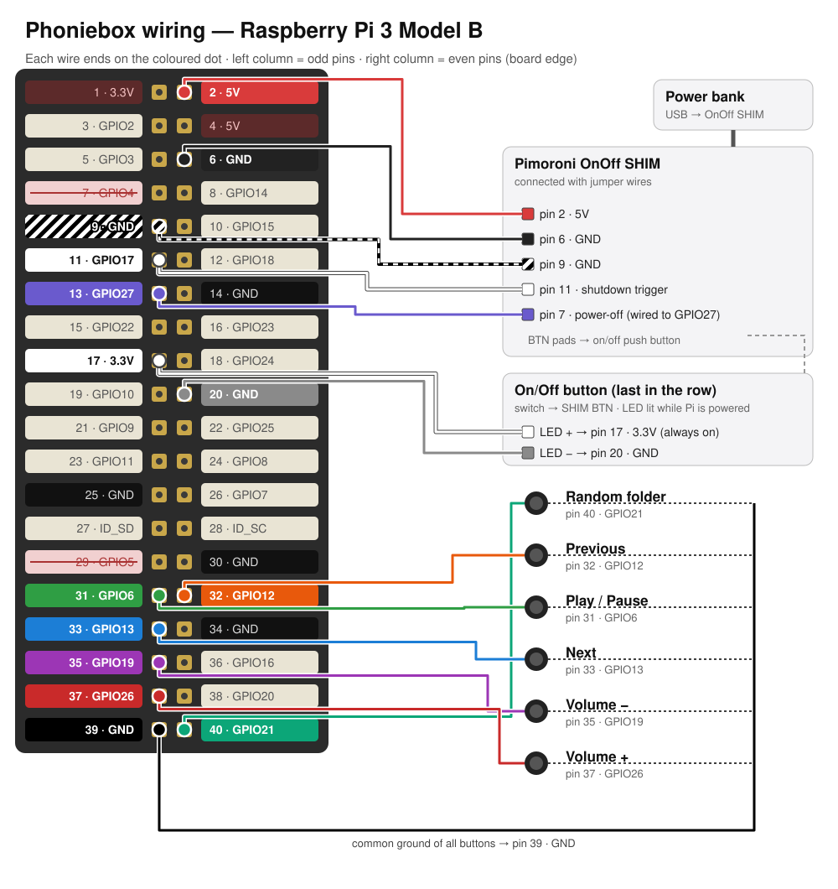
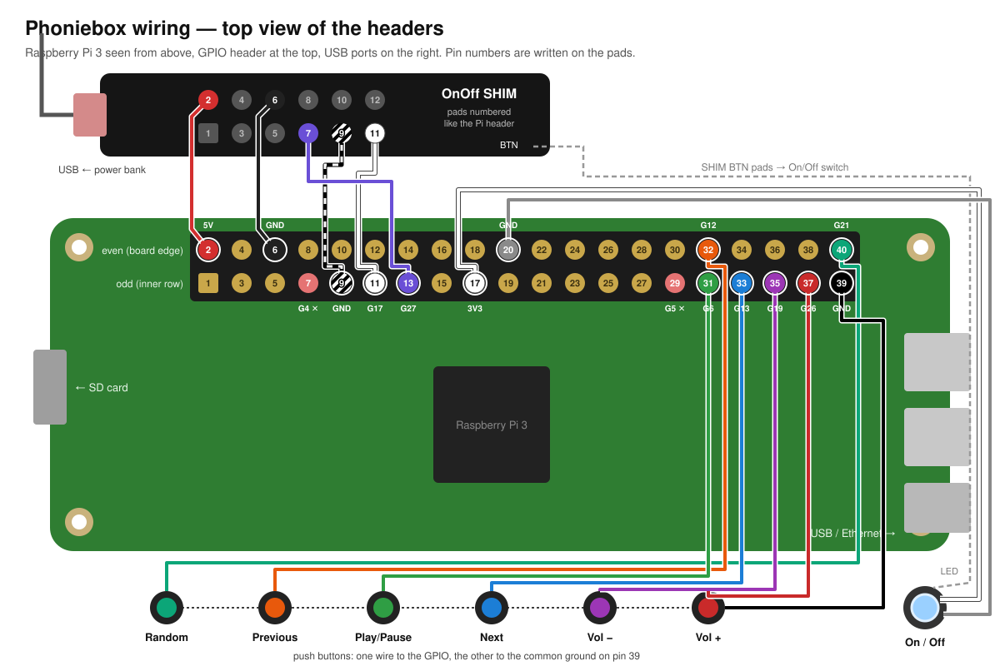
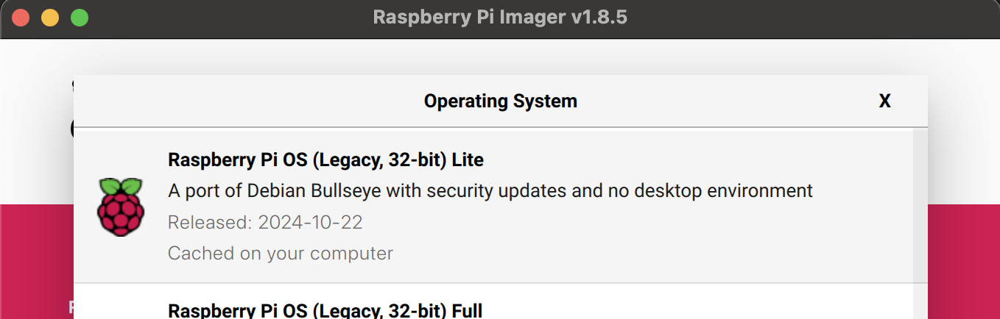
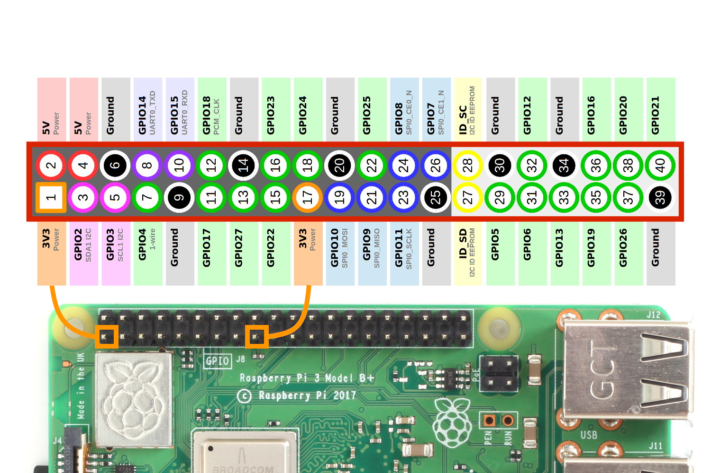
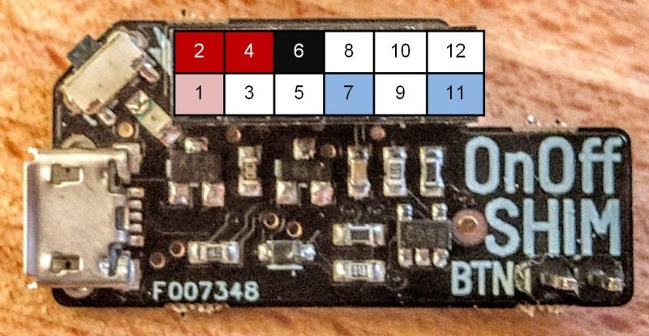
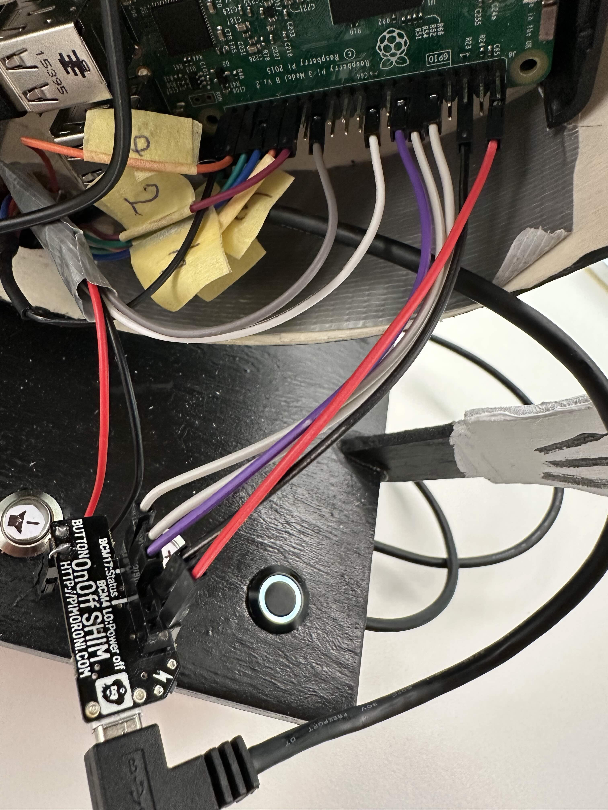

# Phoniebox

This is the [Phoniebox](https://github.com/MiczFlor/RPi-Jukebox-RFID) I created with my kids.


[Watch the video on YouTube](https://www.youtube.com/shorts/znsAAv1EgLk)

<iframe width="560" height="315" src="https://www.youtube.com/shorts/znsAAv1EgLk"
frameborder="0" allow="accelerometer; autoplay; clipboard-write; encrypted-media; gyroscope; picture-in-picture" allowfullscreen>
</iframe>

## Table of Contents
* [Hardware](#hardware)
* [Wiring](#wiring)
* [Raspbian Installation](#raspbian-installation)
* [OnOff SHIM Installation](#onoff-shim-installation)
* [Phoniebox Installation](#phoniebox-installation)
* [Troubleshooting](#troubleshooting)
* [References](#references)

---

## Hardware

* Raspberry Pi 3 Model B (V1.2)
* RFID reader (USB)
* [Pimoroni OnOff SHIM](https://shop.pimoroni.com/products/onoff-shim), connected with jumper wires (not soldered on the header)
* Power bank (plugged into the OnOff SHIM, **not** into the Pi)
* 1 illuminated on/off push button (switch wired to the SHIM button pads, LED wired to the Pi)
* 6 arcade push buttons: Previous, Play/Pause, Next, Volume −, Volume +, Random folder

> ⚠️ **GPIO4 (pin 7) and GPIO5 (pin 29) are damaged on this Raspberry Pi** (they don't follow the internal pull-up/pull-down anymore). They are not used. See [Testing GPIO pins](#testing-gpio-pins) to check your own board.

---

## Wiring



Same wiring, seen from above as it looks on the boards (pin numbers are written on the pads, the OnOff SHIM pads are numbered like the Pi header):



Pin numbers below are **physical pin numbers** (1–40) on the Raspberry Pi header. GPIO names are BCM numbers, which are the ones used in the config files.

### OnOff SHIM

| OnOff SHIM pin | Raspberry Pi pin | Role |
|---|---|---|
| 2 (5V) | **2** (5V) | Power from the SHIM to the Pi |
| 6 (GND) | **6** (GND) | Ground |
| 7 (power-off) | **13** (GPIO27) | Pulled low by the Pi at the end of shutdown → the SHIM cuts power. Default is pin 7 (GPIO4), moved to GPIO27 because GPIO4 is damaged |
| 9 (GND) | **9** (GND) | Ground (black/white striped wire) |
| 11 (trigger) | **11** (GPIO17) — white wire | The SHIM pulls it **low** when the button is pressed → the Pi shuts down |

### Illuminated on/off button

| Button wire | Connected to | Role |
|---|---|---|
| Switch | OnOff SHIM button pads | Press to power on, hold ~1 s to shut down |
| LED + (white wire) | Pi **pin 17** (3.3V) | LED is lit whenever the Pi is powered → shows that the battery is not empty |
| LED − (grey wire) | Pi **pin 20** (GND) | Ground |

No software is needed for the LED: it lights up as soon as the SHIM powers the Pi and turns off when the SHIM cuts power.
If the LED in the button has no built-in resistor, add a 220–330 Ω resistor in series.

### Phoniebox buttons

Buttons on the box, from left to right: Random, Previous, Play/Pause, Next, Volume −, Volume +, then the On/Off button. Each push button has one wire to a GPIO and the other wire to a **common ground on pin 39**.

| Button | Raspberry Pi pin | GPIO (BCM) |
|---|---|---|
| Random folder | 40 | GPIO21 |
| Previous | 32 | GPIO12 *(was GPIO5, damaged)* |
| Play / Pause | 31 | GPIO6 |
| Next | 33 | GPIO13 |
| Volume − | 35 | GPIO19 |
| Volume + | 37 | GPIO26 |
| *(common ground)* | 39 | GND |

> ⚠️ Always unplug the power before connecting or disconnecting wires on the GPIO header. A wire touching the wrong pin (e.g. 5V on a GPIO) can permanently damage the pin.

---

## Raspbian Installation

1. Download and install the Bullseye Lite version of Raspberry Pi OS (Legacy) on an SD card.
   
2. Insert the SD card into your Raspberry Pi and connect it to Ethernet.
3. Install Wi-Fi drivers (not included in the Lite version), configure Wi-Fi settings, and verify the connection. Once confirmed, unplug the Ethernet cable.

   Install Wi-Fi drivers:
   ```bash
   sudo apt install firmware-brcm80211 wpasupplicant wireless-tools
   ```

   Configure Wi-Fi settings:
   ```bash
   sudo nano /etc/wpa_supplicant/wpa_supplicant.conf
   ```

   Example configuration:
   ```bash
   country=CH
   network={
           ssid="SSID"
           psk="Password"
   }
   ```

> On Bullseye the boot partition is mounted at `/boot` (on Bookworm it would be `/boot/firmware`).

---

## OnOff SHIM Installation

The Phoniebox is powered by a power bank, so I needed a power on/off button to safely cut power to the Raspberry Pi.

This [blog](https://koboldimkopf.wordpress.com/2020/01/10/tutorial-phoniebox/) recommended the [OnOff SHIM from Pimoroni](https://shop.pimoroni.com/products/onoff-shim), which was perfect for my needs.




### How it works

The Pimoroni installer sets up the `cleanshutd` daemon (shown at boot as *"LSB: Monitoring GPIO shutdown trigger"*):

1. Holding the button for `hold_time` seconds makes the SHIM pull **GPIO17 low**.
2. `cleanshutd` sees GPIO17 low and runs a clean shutdown.
3. At the very end of the shutdown, the Pi pulls the **power-off pin low** (GPIO27 here) and the SHIM cuts the power.

Install it with the Pimoroni one-liner:
```bash
curl https://get.pimoroni.com/onoffshim | bash
```

### Using GPIO27 instead of GPIO4 for power-off

On my Raspberry Pi, GPIO4 (pin 7) is damaged and stuck, so the low signal was never sent to the SHIM and the Pi was never powered off after shutdown. I connected the SHIM pin 7 to Pi **pin 13 (GPIO27)** with a jumper wire instead.

Edit `/etc/cleanshutd.conf`:
```bash
sudo nano /etc/cleanshutd.conf
```

```bash
# Config for cleanshutd
trigger_pin=17
led_pin=17
poweroff_pin=27  # Changed from default (4) to GPIO27
hold_time=1
shutdown_delay=0
polling_rate=1
```



### Pull-ups at boot (`/boot/config.txt`)

Add these two lines at the end of `/boot/config.txt`:
```bash
gpio=27=ip,pu
gpio=17=ip,pu
```

* `gpio=27=ip,pu` keeps the power-off pin **high** during boot, so the SHIM doesn't cut the power.
* `gpio=17=ip,pu` keeps the trigger pin **high** during boot. **This one is important**: by default GPIO17 is pulled *low* by the Pi. If the SHIM is disconnected or a wire is loose, `cleanshutd` thinks the button is pressed and **shuts the Pi down right after every boot**.

### Extra: service forcing the GPIO27 pull-up

The `config.txt` line alone did not work for me for GPIO27, so I also added a small service that sets the pull-up after boot.

1. Create the script:
   ```bash
   sudo nano /usr/local/bin/force_gpio27_pullup.sh
   ```
   ```bash
   #!/bin/bash
   raspi-gpio set 27 ip pu
   ```
2. Make it executable:
   ```bash
   sudo chmod +x /usr/local/bin/force_gpio27_pullup.sh
   ```
3. Create the service:
   ```bash
   sudo nano /etc/systemd/system/force-gpio27.service
   ```
   ```ini
   [Unit]
   Description=Force GPIO27 pull-up
   After=multi-user.target

   [Service]
   Type=oneshot
   ExecStart=/usr/local/bin/force_gpio27_pullup.sh
   RemainAfterExit=yes

   [Install]
   WantedBy=multi-user.target
   ```
4. Enable it and reboot:
   ```bash
   sudo systemctl enable force-gpio27.service
   sudo reboot
   ```
5. Check GPIO27:
   ```bash
   raspi-gpio get 27
   ```
   It should show:
   ```
   GPIO 27: level=1 fsel=0 func=INPUT pull=UP
   ```

---

## Phoniebox Installation

To install the Phoniebox software, use the one-line install command from the main [documentation](https://github.com/MiczFlor/RPi-Jukebox-RFID/wiki/INSTALL#one-line-install-command):
```bash
cd; rm install-jukebox.sh; wget https://raw.githubusercontent.com/MiczFlor/RPi-Jukebox-RFID/master/scripts/installscripts/install-jukebox.sh; chmod +x install-jukebox.sh; ./install-jukebox.sh
```

It asks some questions and takes approximately 15 minutes to install.

### GPIO configuration

My button configuration is in `~/RPi-Jukebox-RFID/settings/gpio_settings.ini`. The [gpio_control documentation](https://github.com/MiczFlor/RPi-Jukebox-RFID/blob/develop/components/gpio_control/README.md) has more advanced examples, but simple buttons were enough for me.

After making changes, restart the service:
```bash
sudo systemctl restart phoniebox-gpio-control
```

```ini
[DEFAULT]
enabled: True
antibouncehack: False

[Random]
enabled: True
Type: Button
Pin: 21
functionCall: functionCallPlayerRandomFolder

[Prev]
enabled: True
Type: Button
Pin: 12
functionCall: functionCallPlayerPrev

[Pause]
enabled: True
Type: Button
Pin: 6
functionCall: functionCallPlayerPause

[Next]
enabled: True
Type: Button
Pin: 13
functionCall: functionCallPlayerNext

[DOWN]
enabled: True
Type: Button
Pin: 19
functionCall: functionCallVolD

[UP]
enabled: True
Type: Button
Pin: 26
functionCall: functionCallVolU
```

> `Pin` values are **BCM GPIO numbers**, not physical pin numbers (e.g. `Pin: 12` = GPIO12 = physical pin 32).

Available actions (`functionCall`): `functionCallPlayerPrev`, `functionCallPlayerNext`, `functionCallPlayerPause`, `functionCallPlayerPauseForce`, `functionCallPlayerStop`, `functionCallVolU`, `functionCallVolD`, `functionCallPlayerRandomTrack`, `functionCallPlayerRandomCard`, `functionCallPlayerRandomFolder`, `functionCallPlayerSeekFwd`, `functionCallPlayerSeekBack`, `functionCallToggleWifi`, `functionCallBluetoothToggle`, `functionCallShutdown`, …

---

## Troubleshooting

### The Pi shuts down a few seconds after every boot

Symptoms: the boot looks normal, then the screen shows a clean shutdown (`Stopping …` → `Reached target Power-Off`), sometimes with the message `BCM 17 held low, system shutdown`.

Cause: `cleanshutd` reads **GPIO17 low** = "button pressed". This happens when the SHIM is disconnected, or when a jumper wire (pin 11 trigger, 5V or GND) is loose.

Fix:
1. Check the wiring between the SHIM and the Pi, especially pin 11.
2. Make sure `gpio=17=ip,pu` is in `/boot/config.txt` (see [Pull-ups at boot](#pull-ups-at-boot-bootconfigtxt)).

If you can't log in because the Pi turns off too fast, put the SD card in a computer and add the line above to `config.txt` on the boot partition (readable from macOS/Windows).

To temporarily disable services without logging in, you can also add to the end of the (single) line in `cmdline.txt`:
```
systemd.mask=phoniebox-gpio-control.service systemd.mask=phoniebox-idle-watchdog.service
```
Remove it again once the problem is fixed.

### Testing GPIO pins

A healthy input pin follows the internal pull-up (reads `1`) and pull-down (reads `0`). A damaged pin stays stuck. Run this **with nothing connected** to the GPIO header:

```bash
for p in 5 6 12 13 19 21 26 27; do
  sudo raspi-gpio set $p ip pu; sleep 0.5; UP=$(raspi-gpio get $p | grep -o "level=[01]")
  sudo raspi-gpio set $p ip pd; sleep 0.5; DN=$(raspi-gpio get $p | grep -o "level=[01]")
  [ "$UP" = level=1 ] && [ "$DN" = level=0 ] && R="OK" || R="SUSPECT"
  echo "GPIO$p : up=$UP down=$DN -> $R"
done
sudo reboot
```

> ⚠️ Do **not** include GPIO17 in this test: pulling it down triggers `cleanshutd` and shuts the Pi down immediately.

Results on my board: GPIO4 and GPIO5 are **SUSPECT** (stuck), all the other pins used here are OK.

---

## References

Special thanks to the original [Phoniebox](https://github.com/MiczFlor/RPi-Jukebox-RFID/) project and all the tutorials I could find online that helped me set up my OnOff SHIM:
* [Kobold im Kopf Tutorial](https://koboldimkopf.wordpress.com/2020/01/10/tutorial-phoniebox/)
* [SplittScheid Tutorial](https://splittscheid.de/phoniebox-bauanleitung-toniebox-alternative/)
* [YouTube Tutorial](https://www.youtube.com/watch?v=9S8yvfvFSNg)
* [Pimoroni OnOff SHIM / cleanshutd](https://github.com/pimoroni/clean-shutdown)
